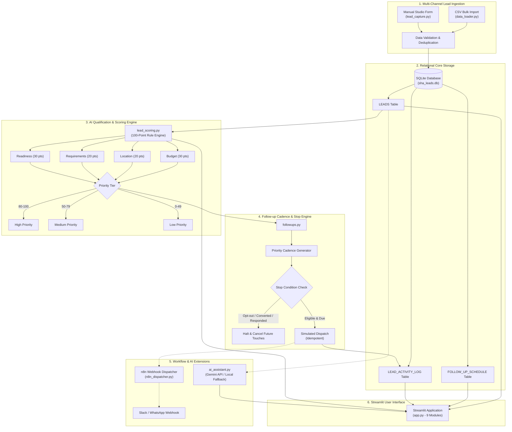

# SHA Interface Interiors &mdash; AI-Powered Lead Management System

An enterprise-grade, privacy-first Lead Management, Qualification, and Automated Follow-up platform engineered specifically for **SHA Interface Interiors**.

---

## 1. Project Overview & Business Problem

High-end interior design studios face unique lead management challenges:
* **High-Ticket, Long Sales Cycles:** Residential turnkey projects range from ₹5 Lakhs to over ₹25 Lakhs. Sales cycles take 30 to 90 days with multiple consultations.
* **Lead Quality Variance:** Inquiries stream in from Instagram, Google Search, walk-ins, and referrals. Without rapid, explainable scoring, design consultants waste hours chasing budget-constrained or unserviceable leads.
* **Outreach Drop-off:** Inconsistent follow-up cadences cause warm leads to churn to competitors. Conversely, continuing automated follow-ups after a customer has replied or converted damages brand reputation.

### The Solution
The **SHA Interface Interiors AI-Powered Lead Management System** provides:
1. **Multi-Channel Ingestion:** Instant intake via CSV import or validated manual consultation forms.
2. **Transparent 100-Point AI Lead Scoring:** Quantifies Budget Suitability (30 pts), Location Suitability (20 pts), Requirements Clarity (20 pts), and Purchase Readiness (30 pts) with plain-English rationales and zero black-box hallucination.
3. **Automated Priority-Driven Follow-up Cadences:** Tailored cadences (High: 3 touches, Medium: 3 touches, Low: 2 touches) in `Asia/Kolkata` time with strict stop conditions (customer response, opt-out, converted, lost) and execution idempotency.
4. **Resilient Integration & Fallbacks:** Production-ready n8n workflows and Google Gemini assistant integration with 100% offline deterministic fallback.

---

## 2. End-to-End System Architecture



---

## 3. Technology Stack

* **Language:** Python 3.10+ (Tested on Python 3.14)
* **Frontend:** Streamlit 1.66+
* **Database:** SQLite 3 with WAL mode, transactions, and foreign keys
* **Data Processing:** Pandas, NumPy, OpenPyXL
* **Automation:** n8n Webhook Integration (JSON exports included)
* **AI/LLM (Optional):** Google Gemini 1.5 Flash (via REST API) with built-in SQLite intelligence fallback

---

## 4. Project Directory Structure

```text
c:\Users\User\Downloads\AI-Powered Interior Design Lead Management System\
├── app.py                     # Streamlit 9-page unified web application
├── database.py                # SQLite schema, CRUD operations, transactions, indexes
├── lead_capture.py            # Manual enquiry form & Indian phone/email validation
├── data_loader.py             # CSV ingestion, deduplication & guardrails
├── lead_scoring.py            # 100-point explainable scoring engine
├── followups.py               # Automated cadences, stop conditions & idempotency
├── followup_templates.py      # 7 personalized message draft templates
├── reports.py                 # Executive KPIs, 9 chart datasets, and periodic reports
├── ai_assistant.py            # Natural language CRM Q&A & recommendation engine
├── n8n_dispatcher.py          # n8n webhook dispatcher with local fallback
├── requirements.txt           # Minimal dependencies
├── .env.example               # Configuration template
├── sha_leads.db               # SQLite database (250 leads populated)
│
├── data/
│   ├── raw/                   # Preserved original files (Leads.csv, dictionary, image.jpg)
│   ├── processed/             # Cleaned education benchmark dataset
│   ├── synthetic/             # 250 domain-specific interior design leads
│   └── backup/                # Pre-migration database snapshots
│
├── n8n_workflows/             # Production-ready n8n workflow definitions
│   ├── workflow_1_new_lead_notification.json
│   ├── workflow_2_high_priority_lead_alert.json
│   ├── workflow_3_followup_reminder.json
│   ├── workflow_4_lead_status_update.json
│   └── README.md
│
├── reports/                   # Technical analysis & assessment reports
│   ├── dataset_preparation_report.md
│   ├── data_quality_summary.csv
│   ├── final_project_report.md
│   └── demo_script.md
│
└── tests/
    ├── test_step3.py          # 9 tests: DB, CSV import, duplicate prevention
    ├── test_lead_scoring.py   # 12 tests: Scoring rules, bounds, immobility
    ├── test_followups.py      # 8 tests: Cadences, stop conditions, idempotency
    └── test_end_to_end.py     # 10 end-to-end customer journey scenarios
```

---

## 5. Database Schema (`sha_leads.db`)

### `LEADS` Table
| Column | Type | Description |
| :--- | :--- | :--- |
| `lead_id` | `TEXT PRIMARY KEY` | Unique identifier (e.g. `SHA-2026-0001`) |
| `customer_name` | `TEXT NOT NULL` | Client name |
| `phone` | `TEXT NOT NULL` | Validated phone number |
| `email` | `TEXT` | Validated email (optional) |
| `city` | `TEXT NOT NULL` | Service location |
| `lead_source` | `TEXT NOT NULL` | Acquisition channel |
| `budget_range` | `TEXT NOT NULL` | Budget tier (Below ₹3L to Above ₹25L) |
| `project_type` | `TEXT NOT NULL` | 1BHK, 2BHK, 3BHK, Villa, Modular Kitchen, Commercial |
| `property_status`| `TEXT NOT NULL` | Ready to Move, Under Construction, etc. |
| `project_timeline`| `TEXT NOT NULL` | Immediately, 1 Month, 3 Months, Exploring |
| `scope_of_work` | `TEXT NOT NULL` | Full Turnkey, Modular Kitchen, Wardrobes, etc. |
| `customer_requirements`| `TEXT` | Custom requirements notes |
| `purchase_readiness`| `TEXT NOT NULL` | Ready to Start, Comparing Vendors, etc. |
| `preferred_contact_method`| `TEXT NOT NULL`| WhatsApp, Phone Call, Email |
| `lead_status` | `TEXT NOT NULL` | New, Qualified, Follow-up, Converted, Lost |
| `lead_score` | `REAL` | AI qualification score (0 to 100) |
| `priority` | `TEXT` | High, Medium, Low |
| `score_breakdown` | `TEXT` | JSON breakdown of sub-scores |
| `scoring_reason` | `TEXT` | Plain-English explanation |
| `is_opted_out` | `INTEGER` | 1 if client opted out, else 0 |
| `last_customer_response`| `TEXT` | Inbound message content |
| `created_at` / `updated_at`| `TEXT` | ISO 8601 timestamps |
| `data_origin` | `TEXT` | `synthetic_import`, `manual_entry`, `csv_import` |

### `FOLLOW_UP_SCHEDULE` Table
Stores individual touchpoint tasks (`schedule_id`, `lead_id`, `scheduled_for`, `channel`, `message`, `status`, `attempt_number`, `created_at`, `completed_at`, `stop_reason`).

### `LEAD_ACTIVITY_LOG` Table
Audit trail recording all lifecycle actions, status changes, and customer responses (`activity_id`, `lead_id`, `activity_type`, `activity_description`, `timestamp`).

---

## 6. Lead Scoring Formula (100 Points)

1. **Budget Suitability (30 Pts):**
   * Above ₹25 lakh = 30 pts | ₹10L–₹25L = 25 pts | ₹5L–₹10L = 18 pts | ₹3L–₹5L = 10 pts | Below ₹3L = 2 pts
2. **Location Suitability (20 Pts):**
   * Tier 1 (Bangalore, Hyderabad) = 20 pts
   * Tier 2 (Chennai, Mumbai, Pune) = 14 pts
   * Tier 3 (Delhi NCR) = 8 pts | Out of area = 0 pts
3. **Requirements Clarity (20 Pts):**
   * Valid Project Type (4) + Property Status (4) + Timeline (4) + Scope (4) + Custom Notes (2-4) = 20 pts
4. **Purchase Readiness (30 Pts):**
   * Ready to Start = 30 pts | Comparing Vendors = 22 pts | Budget Planning = 12 pts | Just Exploring = 4 pts

**Priority Bands:**
* 🟢 **High Priority (80–100):** Immediate consultant assignment.
* 🟡 **Medium Priority (50–79):** Lookbook sharing & portfolio nurturing.
* 🔴 **Low Priority (0–49):** Self-service digital catalog.

---

## 7. Automated Follow-up Cadences & Stop Conditions

| Priority Tier | Cadence Schedule (Asia/Kolkata Time) |
| :--- | :--- |
| **High Priority** | Touch 1: 1 day after intake (WhatsApp) &bull; Touch 2: +3 days (Call) &bull; Touch 3: +7 days (Email) |
| **Medium Priority** | Touch 1: 2 days after intake (WhatsApp) &bull; Touch 2: +5 days (Email) &bull; Touch 3: +10 days (WhatsApp) |
| **Low Priority** | Touch 1: 7 days after intake (Email) &bull; Touch 2: +14 days (WhatsApp) |

### Stop Conditions:
Before any touchpoint executes, the engine checks:
1. Has the customer responded? $\rightarrow$ **Halt future touches** and assign designer.
2. Has the customer opted out? $\rightarrow$ **Cancel all touches** permanently.
3. Is lead marked **Converted** or **Lost**? $\rightarrow$ **Cancel all touches**.
4. Has a sales rep paused outreach? $\rightarrow$ **Halt until resumed**.

---

## 8. Installation & Launch Instructions

### Prerequisites
* Python 3.10+ installed
* Virtual environment (recommended)

### Step 1: Clone or navigate to the project directory
```powershell
cd "c:\Users\User\Downloads\AI-Powered Interior Design Lead Management System"
```

### Step 2: Install dependencies
```powershell
pip install -r requirements.txt
```

### Step 3: Configure environment (Optional)
```powershell
copy .env.example .env
# Edit .env to set GEMINI_API_KEY or N8N_BASE_URL if desired
```

### Step 4: Run the automated test suite
```powershell
python test_end_to_end.py
```

### Step 5: Launch the Streamlit application
```powershell
python -m streamlit run app.py
```
Open your browser at: **`http://localhost:8501`**

---

## 9. Security & Governance

* **Zero Hardcoded Secrets:** All external API endpoints and keys are loaded via environment variables.
* **PII Protection:** Test datasets contain strictly synthetic Indian names, dummy emails (`@example.com`), and non-routable numbers (`+91 91234 XXXXX`).
* **Safe External Communications:** Follow-up dispatches operate in simulated execution mode. No external WhatsApp/Email messages are sent without verified API configuration.
* **Dataset Isolation:** Original Kaggle education datasets remain segregated in `data/raw/` and cannot be imported into the active CRM.
