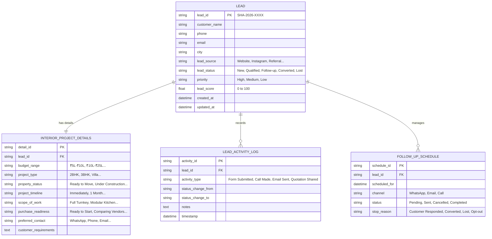

# Dataset Preparation & Data Quality Report: SHA Interface Interiors

**System:** AI-Powered Interior Design Lead Management System  
**Client:** SHA Interface Interiors  
**Prepared by:** Senior Data & AI/ML Engineer  
**Date:** November 2026  
**Status:** Step 2 Complete (Awaiting User Sign-Off)

---

## 1. Executive Summary & Environment Setup

This report documents the rigorous data cleaning, anomaly detection, leakage prevention, and domain enrichment conducted for SHA Interface Interiors. 

All raw files have been preserved in `data/raw/` in an uncompromised, read-only state. Two distinct, unmixed data pipelines are established:
1. **Historical Legacy Pipeline (`data/processed/education_leads_cleaned.csv`)**: Cleaned version of the 9,240 records from the raw education benchmark dataset, identifying data leakage risks.
2. **Interior Design Enquiries Pipeline (`data/synthetic/interior_design_leads.csv`)**: 250 realistic, domain-specific fictional customer inquiries tailored to SHA Interface Interiors' business model (budgets, floor plans, possession timelines, and scopes).

### Directory & File Structure
```text
c:\Users\User\Downloads\AI-Powered Interior Design Lead Management System\
├── data/
│   ├── raw/
│   │   ├── Leads.csv                   (2,368,803 bytes, unmodified source)
│   │   ├── Leads Data Dictionary.xlsx  (11,910 bytes, unmodified dictionary)
│   │   └── image.jpg                   (27,071 bytes, project graphic)
│   ├── processed/
│   │   └── education_leads_cleaned.csv (9,240 rows × 23 columns)
│   └── synthetic/
│       └── interior_design_leads.csv   (250 rows × 16 columns)
├── reports/
│   ├── dataset_preparation_report.md   (Comprehensive engineering report)
│   └── data_quality_summary.csv        (Feature-by-feature quality matrix)
├── Leads.csv                           (Root original file, preserved)
├── Leads Data Dictionary.xlsx          (Root original file, preserved)
└── image.jpg                           (Root original file, preserved)
```

---

## 2. Original Dataset Dimensions & Integrity Validation

| Metric | Raw Dataset (`data/raw/Leads.csv`) | Cleaned Dataset (`data/processed/education_leads_cleaned.csv`) |
| :--- | :---: | :---: |
| **Total Rows** | 9,240 | 9,240 |
| **Total Columns** | 37 | 23 |
| **Duplicate Rows** | 0 | 0 |
| **Duplicate Prospect IDs** | 0 (100% Unique) | 0 (100% Unique) |
| **Duplicate Lead Numbers** | 0 (100% Unique) | 0 (100% Unique) |
| **Target Variable (`Converted`)** | 0: 5,679 (61.46%)<br>1: 3,561 (38.54%) | 0: 5,679 (61.46%)<br>1: 3,561 (38.54%) |
| **Unintended Missing Values** | Standard NaNs + Form "Select" | 0 Unhandled NaNs |

---

## 3. Cleansing & Anomaly Resolution Strategy

### 3.1 Handling Form Placeholder `"Select"` Values
In web inquiry forms, unselected dropdown options were recorded as literal `"Select"` strings. Across the 37 raw features, **13,380 `"Select"` instances** were present. These were converted to true missing values (`NaN`) and properly addressed rather than left to contaminate text and categorical fields.

### 3.2 Imputation & Categorical Standardization
* **`City`** (3,669 effective missing / Select): Imputed with explicit category `"Unknown / Not Specified"`.
* **`Specialization`** (3,380 effective missing / Select): Imputed with `"Other / Not Specified"`.
* **`What is your current occupation`** (2,690 missing): Imputed with `"Unspecified"`.
* **`Lead Source`** (36 missing) & **`Country`** (2,461 missing): Imputed with `"Unknown"`.
* **`TotalVisits` & `Page Views Per Visit`** (137 missing / 1.48%): Imputed with median values (visits = 3, page views = 2.0) to maintain numerical integrity without discarding valid leads.
* **Strings**: Trimmed all trailing and leading whitespace across all string columns.

---

## 4. Columns Removed & Technical Rationales

A total of **14 columns** were removed from `data/processed/education_leads_cleaned.csv`. None of them contained useful predictive signal or business variance:

| Feature Name | Removal Category | Missing / Dominant % | Technical Justification |
| :--- | :--- | :---: | :--- |
| `Magazine` | Zero Variance | 100.0% 'No' | Constant feature; zero entropy / zero variance. |
| `Receive More Updates About Our Courses` | Zero Variance | 100.0% 'No' | Constant feature; zero predictive utility. |
| `Update me on Supply Chain Content` | Zero Variance | 100.0% 'No' | Constant feature; zero predictive utility. |
| `Get updates on DM Content` | Zero Variance | 100.0% 'No' | Constant feature; zero predictive utility. |
| `I agree to pay the amount through cheque` | Zero Variance | 100.0% 'No' | Constant feature; zero predictive utility. |
| `Do Not Call` | Near-Zero Variance | 99.98% 'No' | Only 2 'Yes' out of 9,240 records; non-informative. |
| `Search` | Near-Zero Variance | 99.85% 'No' | 14 'Yes' out of 9,240 records; uninformative. |
| `Newspaper Article` | Near-Zero Variance | 99.98% 'No' | Only 2 'Yes' out of 9,240 records. |
| `X Education Forums` | Near-Zero Variance | 99.99% 'No' | Only 1 'Yes' out of 9,240 records. |
| `Newspaper` | Near-Zero Variance | 99.99% 'No' | Only 1 'Yes' out of 9,240 records. |
| `Digital Advertisement` | Near-Zero Variance | 99.96% 'No' | Only 4 'Yes' out of 9,240 records. |
| `Through Recommendations` | Near-Zero Variance | 99.92% 'No' | Only 7 'Yes' out of 9,240 records. |
| `How did you hear about X Education` | Severe Missingness | 78.46% missing | 5,043 'Select' + 2,207 NaNs; highly fragmented, uninformative. |
| `Lead Profile` | Severe Missingness | 74.19% missing | 4,146 'Select' + 2,709 NaNs; redundant subjective classification. |

---

## 5. Potential Data Leakage Investigation

A critical requirement in enterprise lead scoring is **preventing target leakage (lookahead bias)**. Data leakage occurs when a model uses features during training that would only exist *after* the customer has been engaged, qualified, or converted.

### Critical Leakage Findings:
1. **`Tags` (Severe Target Leakage Risk)**:
   * Values like `"Closed by Horizzon"` (358 leads, 99.4% converted) and `"Lost to EINS"` (175 leads, 97.7% conversion outcome) are assigned by sales agents *at the conclusion of the sales cycle*.
   * Values like `"Ringing"` (1,203 leads, 2.8% converted), `"switched off"` (240 leads, 1.7% converted), and `"Will revert after reading the email"` (2,072 leads, 96.9% converted) are entered *during mid-funnel telephonic calling*.
   * **Rule for SHA Lead Scoring**: `Tags` must **NEVER** be used to score a freshly captured lead. It is strictly an operational CRM disposition field for sales tracking.
2. **`Lead Quality` (Post-Contact Subjective Leakage)**:
   * 51.59% missing. Values (`High in Relevance`, `Might be`, `Low in Relevance`, `Worst`) reflect an employee's subjective assessment *after* speaking with the customer.
3. **`Last Activity` & `Last Notable Activity` (Pipeline State Leakage)**:
   * Activities like `"SMS Sent"`, `"Had a Phone Conversation"`, or `"Approached upfront"` record downstream interactions.
   * At the moment of initial inquiry creation, the only valid activity is the inbound event (e.g., Form Submission, Initial Chat). Downstream interactions must not bias initial lead qualification.
4. **`Asymmetrique Scores` (Post-Processing Metric)**:
   * 45.65% missing. Calculated via batch rating algorithms after agent reviews.

*Conclusion: In `education_leads_cleaned.csv`, these fields are retained for historical auditability and CRM timeline simulation, but are strictly flagged as prohibited inputs for intake-time lead qualification.*

---

## 6. Synthetic Interior Design Dataset (`interior_design_leads.csv`)

To thoroughly test the upcoming lead capture, scoring, and follow-up modules with genuine interior design domain parameters, a synthetic dataset of **250 realistic fictional customer inquiries** was constructed.

### 6.1 Dataset Specifications
* **File Location**: `data/synthetic/interior_design_leads.csv`
* **Total Records**: 250 (exceeds requirement of 200)
* **Total Features**: 16
* **Missing Values**: 0 (all fields 100% complete)
* **Lead ID Integrity**: 100% Unique (`SHA-2026-0001` through `SHA-2026-0250`)
* **Privacy & Compliance**: 100% fictional names, synthetic emails (`@example.com`), and dedicated test phone prefixes (`+91 91234 XXXXX`). No real personal data is present.

### 6.2 Field Dictionary

| Field Name | Type | Allowed Categories / Examples | Business Purpose |
| :--- | :--- | :--- | :--- |
| `Lead_ID` | String | `SHA-2026-0001` to `SHA-2026-0250` | Primary unique key for CRM tracking. |
| `Customer_Name` | String | Realistic Indian names (e.g., Sneha Iyer, Ramesh Yadav) | Customer identity. |
| `Phone` | String | Fictional test numbers (`+91 91234 10001`+) | Contact channel for calls/SMS. |
| `Email` | String | `firstname.lastname@example.com` | Automated quotation & follow-up delivery. |
| `Lead_Source` | String | `Website Inquiry`, `Instagram Ad`, `Google Search`, `Architect Referral`, `Past Client Referral`, `Walk-in Studio`, `Facebook Campaign`, `Housing Portal` | Attribution tracking & channel ROI. |
| `City` | String | `Bangalore`, `Hyderabad`, `Chennai`, `Mumbai`, `Pune`, `Delhi NCR` | Service territory & site inspection routing. |
| `Budget_Range` | Categorical | `Below ₹3 lakh`, `₹3 lakh–₹5 lakh`, `₹5 lakh–₹10 lakh`, `₹10 lakh–₹25 lakh`, `Above ₹25 lakh` | Financial capacity for scoring engine. |
| `Project_Type` | Categorical | `1BHK`, `2BHK`, `3BHK`, `Villa`, `Modular Kitchen`, `Commercial/Office` | Scope complexity and space planning. |
| `Property_Status` | Categorical | `Ready to Move`, `Possession within 30 days`, `Possession within 1–3 months`, `Under Construction` | Urgency indicator & readiness. |
| `Project_Timeline`| Categorical | `Immediately`, `Within 1 month`, `Within 3 months`, `Within 6 months`, `Just Exploring` | Time-to-conversion planning. |
| `Scope_of_Work` | Categorical | `Full Turnkey Interior`, `Modular Kitchen`, `Wardrobe`, `Renovation`, `Furniture and Woodwork`, `Commercial Interiors` | Trade allocation & quotation sizing. |
| `Customer_Requirements` | Text | Detailed specifications (e.g., "Contemporary Scandinavian theme for 3BHK flat; acrylic modular kitchen, walk-in wardrobe") | Unstructured notes for design consultants. |
| `Purchase_Readiness` | Categorical | `Ready to Start`, `Comparing Vendors`, `Budget Planning`, `Just Exploring` | Core intent driver for AI lead scoring. |
| `Preferred_Contact_Method` | Categorical | `Phone Call`, `WhatsApp`, `Email`, `In-Person Consultation` | Follow-up automation channel selector. |
| `Lead_Status` | Categorical | `New`, `Qualified`, `Follow-up`, `Converted`, `Lost` | CRM stage progression. |
| `Created_Date` | Date | `2026-07-01` to `2026-10-31` (ISO 8601) | Intake date for aging and SLAs. |

---

## 7. Comparative Analysis: Education vs. Interior Design Data

| Dimension | Education Dataset (`Leads.csv`) | Interior Design Dataset (`interior_design_leads.csv`) |
| :--- | :--- | :--- |
| **Business Domain** | Higher education / course enrollment. | High-ticket residential & commercial interior design. |
| **Primary Value Drivers** | Website engagement time, email opens, occupation. | Budget range, property possession date, square footage / project type. |
| **Sales Cycle Duration** | 7–21 days (transactional decision). | 30–90 days (multi-meeting consultations, 3D renders, site visits). |
| **Data Cleanliness** | Form dropdowns contained "Select" & uncurated text. | Standardized categorical enumerations with zero nulls. |
| **Lead Quality Determinant** | Digital activity time, representative tag notes. | Budget adequacy, project scale, and readiness to initiate work. |
| **Target Variable** | Historical binary `Converted` (38.5%). | Granular `Lead_Status` (`New`, `Qualified`, `Follow-up`, `Converted`, `Lost`). |

---

## 8. Unified CRM Data Architecture Recommendation

To support both **imported bulk leads** and **new real-time interior design inquiries**, the CRM database must use an entity model that avoids mingling domain-specific fields while providing seamless pipeline tracking.



### How Future Real Inquiries Will Ingest:
1. **Intake API / Web Form (Step 3)**: Incoming payload writes to `LEAD` and `INTERIOR_PROJECT_DETAILS`.
2. **AI Lead Scoring Engine (Step 4)**: Calculates `lead_score` (0–100) and assigns `priority` (`High`, `Medium`, `Low`) based on budget, location, readiness, and timeline.
3. **CRM Pipeline (Step 5)**: Updates `lead_status` as designers conduct consultations and share mood boards.
4. **Follow-Up Automation (Step 6)**: Automatically generates reminders in `FOLLOW_UP_SCHEDULE` and ceases outreach upon trigger of a stop condition.

---

## 9. Verification & Sign-Off Checklist

- [x] Raw files preserved without modification in `data/raw/` and project root.
- [x] Cleaned education dataset verified with 9,240 rows, 23 columns, and 0 unprocessed "Select" values.
- [x] Potential data leakage fields (`Tags`, `Lead Quality`, `Last Activity`) comprehensively documented with usage constraints.
- [x] Synthetic interior design dataset created with 250 rows, 16 columns, 0 nulls, and 100% unique IDs.
- [x] Data quality CSV generated at `reports/data_quality_summary.csv`.
- [x] Unified database schema designed for upcoming SQLite implementation.
